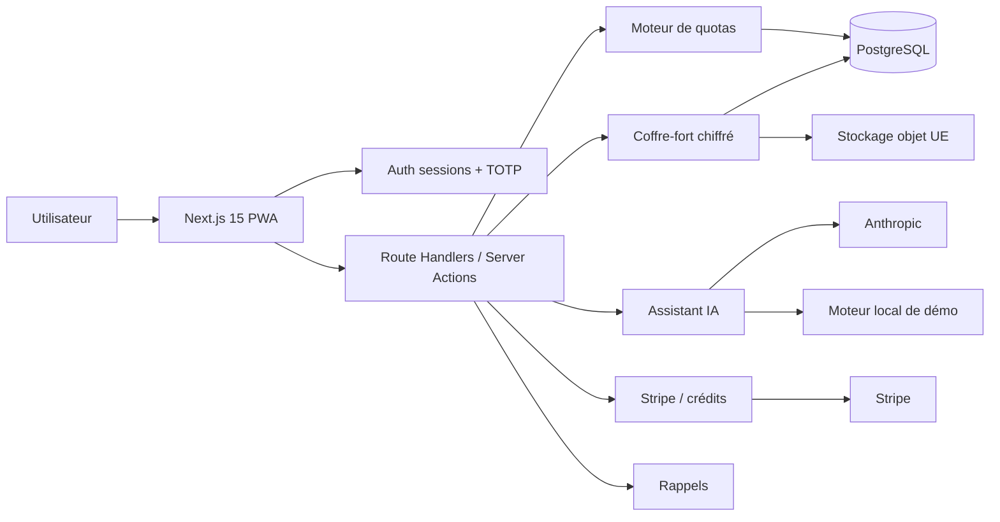
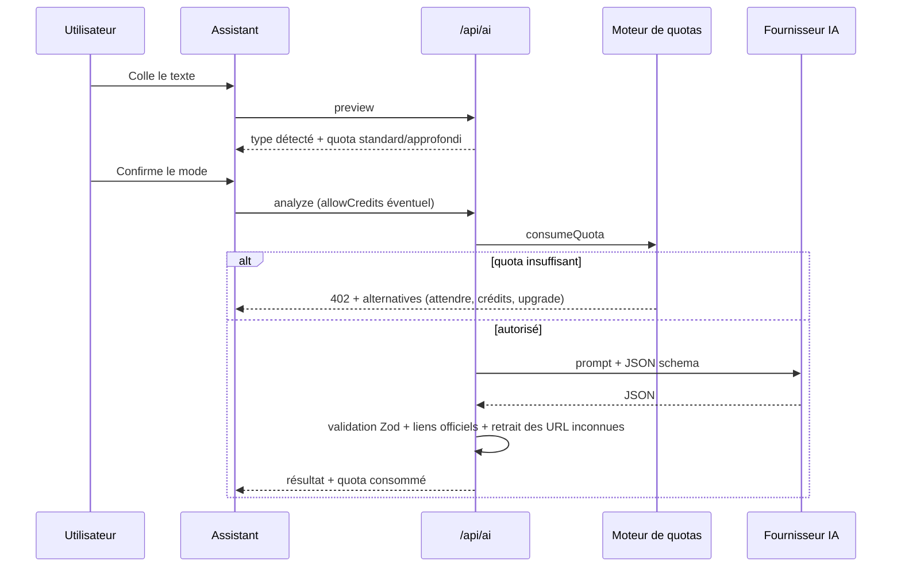
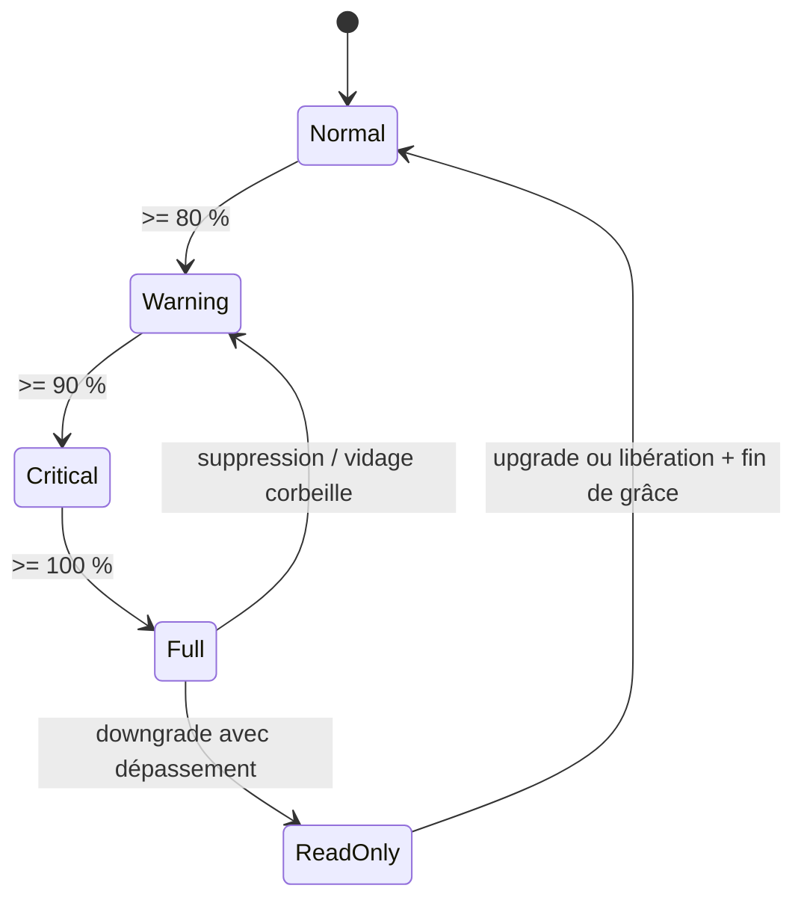
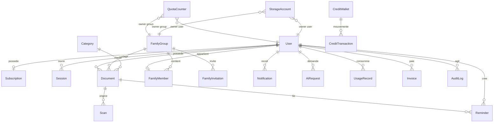

# Architecture Klerio

## Vue d'ensemble

## Flux critiques

### Scan → PDF → coffre

1. Le client capture/importe des images, les recadre et les améliore sur un canvas.
2. `pdf-lib` assemble un PDF A4 ; le nombre de pages est connu avant l'envoi.
3. Le client affiche le quota restant, le coût en crédits éventuel, et demande un consentement si nécessaire.
4. `POST /api/documents` :
   - vérifie la session et le rate limit ;
   - analyse le PDF (nombre de pages réel) ;
   - `consumeQuota(scan_pages, pages)` dans une transaction (inclus puis crédits) ;
   - chiffre le fichier (DEK aléatoire + KEK maître) ;
   - écrit le blob, crée `Document` + `Scan`, incrémente le stockage avec garde-fou ;
   - en cas d'échec, supprime le blob et **rembourse** le quota ;
   - en cas de doublon SHA-256, rembourse et renvoie le document existant.
5. L'aperçu passe par `/api/documents/[id]/file`, qui vérifie l'appartenance (ou un partage famille explicite) et déchiffre à la volée.

### Analyse IA avec transparence

- Les documents spéciaux (notaire, acte, contrat complexe) imposent l'analyse approfondie.
- Une erreur du fournisseur IA rembourse le quota et bascule sur le moteur local, signalé à l'utilisateur.
- L'IA ne produit jamais d'URL : elle choisit un `slug`; le serveur résout l'URL depuis `OfficialLink` et vérifie le domaine.

### Stockage

- Écritures bloquées à `full` et `read_only`; lecture, export et suppression toujours possibles.
- Corbeille : `status=trash`, `purgeAt = now + 30 j`, octets toujours comptés.
- Downgrade : `graceEndsAt = now + 60 j`, état `read_only`, aucun fichier supprimé.
- Famille : un `StorageAccount` de type `group`; limite individuelle optionnelle contrôlée avant l'écriture.

## Modèle de données

Points importants :

- `QuotaCounter` a une clé unique `(ownerType, ownerId, type, periodKey)` : un compteur par période, ce qui rend les resets naturels et l'historique conservé.
- `StorageAccount` est distinct des quotas IA et des pages.
- `CreditWallet` / `CreditTransaction` ne sont **jamais** fusionnés avec les quotas inclus.
- `Document.visibility` (`private`/`family`) et `groupId` séparent strictement les contenus familiaux.
- `UsageRecord.refundedAt` garantit un remboursement unique.
- `StripeEvent` assure l'idempotence des webhooks.

## Décisions d'architecture

1. **Un moteur pur + un service transactionnel.** Les règles sont testables sans base ; la persistance est isolée.
2. **Fenêtres calculées à la demande.** Pas de cron pour réinitialiser : le `periodKey` change et un nouveau compteur démarre. Aucune tâche de reset à rater.
3. **Transactions courtes.** Les appels IA et les écritures de fichiers se font hors transaction ; les débits sont compensés en cas d'échec.
4. **Chiffrement enveloppe.** Une clé maître compromise ne donne pas les fichiers sans les clés enveloppes ; une clé de fichier compromise ne donne qu'un fichier.
5. **Accès famille au niveau requête, pas au niveau UI.** L'administrateur ne peut pas lire un document privé, même en modifiant l'URL.
6. **Le mock IA est un citoyen de première classe.** Il permet de tester quotas, UI et erreurs sans clé, sans prétendre remplacer un modèle.

## Points à consolider

- Verrous de ligne PostgreSQL (`SELECT ... FOR UPDATE`) pour sérialiser les débits concurrents sur un même compteur.
- File d'attente pour l'OCR, les e-mails et les push.
- Chiffrement des métadonnées sensibles (titre, OCR) dans une V2.
- Rotation de la clé maître et ré-chiffrement progressif.
- Tests E2E et tests de charge sur le moteur.
